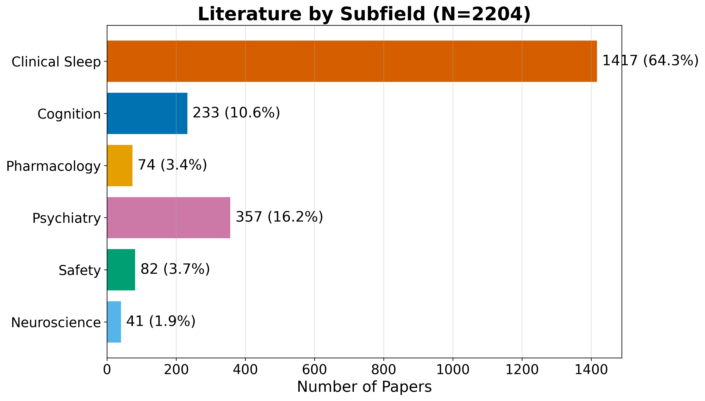

# Literature Meta-Analysis Template

A generic, idempotent **literature meta-analysis** exemplar. Point one config key at
a search term and get a reproducible meta-analysis of the literature: multi-engine
retrieval with graceful degradation, record de-duplication, full-text resolution,
descriptive statistics, language/entity analysis, document embeddings, citation and
temporal bibliometrics, an optional knowledge-graph layer, and an auto-injected
manuscript.



The default topic is modafinil. The [bundled synthetic corpus](docs/fixtures.md)
exercises the offline analysis workflow. The tracked figure above belongs to the
[publication snapshot](docs/output_inventory.md).

Start with the [documentation index](docs/README.md), [quickstart](docs/quickstart.md),
or [offline rendering guide](docs/rendering_pipeline.md).

Full-text provenance has two intentionally separate surfaces: `output/data/fulltext_assessment.json`
summarizes declared corpus availability, while `output/fulltext/fulltext_inventory.json`
records provider/license metadata and SHA-256 checksums only for PDFs actually present
in the local output tree. The inventory never infers a license from an open-access flag.

## When to use this template

Use it whenever the research object is *a body of literature about a topic* and you
want every reported number to trace to committed, regenerable artifacts.

Typical uses:

- Systematic / scoping reviews and meta-analyses around a search term.
- Bibliometric and science-of-science studies (growth curves, citation networks,
  topic structure, author productivity).
- Corpus NLP over titles/abstracts/full text (entities, keyphrases, embeddings,
  clustering).
- Teaching reproducible-research workflow on a realistic, multi-engine retrieval
  problem.

Reach for a sibling exemplar instead when your claims trace to *your own code/data*
(`template_code_project`), to a prose argument (`template_prose_project`), to a
deterministic AutoResearch loop (`template_autoresearch_project`), or to a
**multi-phase review** with distinct retrieval phases and cross-phase provenance
(`template_advanced_literature_review`).

## Publication and rendering

The publishing metadata and per-platform status below are **compiled from
`docs/manuscript/config.yaml`** by `infrastructure.publishing.status_report` — do not
hand-edit between the markers; update the config and regenerate (see the legend).

<!-- PUBLISHING-STATUS:START (generated by infrastructure.publishing.status_report) -->
**A Living Meta-Analysis of the Modafinil Literature** · v0.1.0 · CC-BY-4.0 · Daniel Ari Friedman

Concept DOI: [10.5281/zenodo.20931964](https://doi.org/10.5281/zenodo.20931964) | Version DOI: [10.5281/zenodo.20931965](https://zenodo.org/records/20931965) | Repository: [docxology/template_literature_meta_analysis](https://github.com/docxology/template_literature_meta_analysis)

Publishing surface — 20 platforms, 9 published:

| Platform | Tier | Status | Reference | Credentials |
| --- | --- | --- | --- | --- |
| zenodo | first-class | ✅ published | [10.5281/zenodo.20931964](https://doi.org/10.5281/zenodo.20931964) | `ZENODO_API_TOKEN` |
| github | first-class | ✅ published | [docxology/template_literature_meta_analysis](https://github.com/docxology/template_literature_meta_analysis) | `GITHUB_TOKEN` |
| arxiv | first-class | ⚪ available | — | — |
| pypi | first-class | ✅ published | [https://test.pypi.org/project/template-literature-meta-analysis/0.1.0/](https://test.pypi.org/project/template-literature-meta-analysis/0.1.0/) | `PYPI_TOKEN`, `TESTPYPI_TOKEN` |
| ipfs_pinata | first-class | ✅ published | [https://gateway.pinata.cloud/ipfs/QmbeNkcrBdccxaPihkcjRxLNagNeYLFaGA7xgi5aXEigM1](https://gateway.pinata.cloud/ipfs/QmbeNkcrBdccxaPihkcjRxLNagNeYLFaGA7xgi5aXEigM1) | `PINATA_JWT` |
| ipfs_web3storage | first-class | ⚪ available | — | `WEB3_STORAGE_TOKEN` |
| software_heritage | first-class | ✅ published | [https://archive.softwareheritage.org/browse/origin/?origin_url=https://github.com/docxology/template_literature_meta_analysis](https://archive.softwareheritage.org/browse/origin/?origin_url=https://github.com/docxology/template_literature_meta_analysis) | — |
| github_pages | first-class | ✅ published | [https://docxology.github.io/template_literature_meta_analysis/](https://docxology.github.io/template_literature_meta_analysis/) | `GITHUB_TOKEN` |
| cloudflare_pages | first-class | ⚪ available | — | `CLOUDFLARE_API_TOKEN` |
| netlify | first-class | ✅ published | [https://6a444119738f1fa89d68e5a2--tranquil-kleicha-0c9203.netlify.app](https://6a444119738f1fa89d68e5a2--tranquil-kleicha-0c9203.netlify.app) | `NETLIFY_AUTH_TOKEN` |
| huggingface_hub | first-class | ✅ published | [https://huggingface.co/datasets/ActiveInference/template_literature_meta_analysis](https://huggingface.co/datasets/ActiveInference/template_literature_meta_analysis) | `HUGGINGFACE_TOKEN`, `HF_TOKEN` |
| osf | first-class | ✅ published | [https://osf.io/3z5yp/](https://osf.io/3z5yp/) | `OSF_TOKEN` |
| amazon_kdp | documented | 🟡 planned | — | `AMAZON_KDP_EMAIL`, `AMAZON_KDP_PASSWORD` |
| google_play_books | documented | 🟡 planned | — | `GOOGLE_PLAY_BOOKS_SERVICE_ACCOUNT_JSON` |
| gumroad | documented | 🟡 planned | — | `GUMROAD_ACCESS_TOKEN` |
| leanpub | documented | 🟡 planned | — | `LEANPUB_API_KEY` |
| lulu | documented | 🟡 planned | — | `LULU_CLIENT_KEY`, `LULU_CLIENT_SECRET` |
| draft2digital | documented | 🟡 planned | — | `DRAFT2DIGITAL_API_TOKEN` |
| stripe | documented | 🟡 planned | — | `STRIPE_SECRET_KEY`, `STRIPE_PUBLISHABLE_KEY` |
| ingramspark | documented | 🟡 planned | — | `INGRAMSPARK_CLIENT_ID`, `INGRAMSPARK_CLIENT_SECRET` |

_Keywords: modafinil, meta-analysis, literature retrieval, bibliometrics, record de-duplication, full-text mining, document embeddings, citation network, topic modeling, entity extraction, wakefulness, cognitive enhancement, reproducible research._

_Status legend: ✅ published (durable identifier recorded in `config.yaml`) · 🔵 reserved (identifier reserved but not yet registered by final publication) · ⚪ available (adapter implemented and locally verifiable) · 🟡 planned. This block is generated — edit `docs/manuscript/config.yaml`, then regenerate with `uv run python -m infrastructure.publishing.status_report --project <path> --write`._
<!-- PUBLISHING-STATUS:END -->

See the [rendering guide](docs/rendering_pipeline.md) for the pinned
[docxology/template](https://github.com/docxology/template) workflow and the
[standalone publication guide](docs/standalone.md) for release surfaces.

## What you get

| Capability | Where |
| --- | --- |
| Ten-engine dispatch (arXiv, OpenAlex, Semantic Scholar, Crossref, PubMed, SovietRxiv, ChinaRxiv, Europe PMC, bioRxiv, medRxiv) with per-engine on/off toggles and graceful `skipped` degradation when a key/network is absent | `src/literature/*_client.py`, `src/literature/search_runner.py` |
| Canonical `Paper` record + de-duplication/merge by DOI / PMID / arXiv / S2 / OpenAlex / title-hash | `src/literature/models.py`, `src/literature/corpus.py` |
| Full-text resolution + download (Unpaywall / OA / direct PDF), opt-in & network-gated | `src/literature/fulltext_download.py` |
| Descriptive statistics + consolidated meta-analysis report (counts, citation distribution + Gini, author productivity) | `src/analysis/descriptive_stats.py` |
| Language & entity analysis over title/abstract/full text (offline, no LLM required) | `src/analysis/entities.py`, `src/analysis/text_processing.py` |
| Document embeddings (offline deterministic TF-IDF→SVD) for title/abstract/full text + similarity, clustering, 2-D projection | `src/analysis/embeddings.py` |
| Topic modeling (NMF), temporal trends, citation network (networkx) | `src/analysis/{topic_modeling,temporal_analysis,citation_network}.py` |
| Optional knowledge-graph layer: assertion extraction, hypothesis scoring, RDF/TriG nanopublications (LLM-gated, offline-safe) | `src/knowledge_graph/` |
| Optional reproducibility assessment: workflow-graph extraction, content/structure scores, and full-text quote verification | `src/reproducibility/`, `scripts/10_reproducibility_assessment.py` |
| Publication-ready figures + auto-injected manuscript | `src/visualization/`, `src/manuscript/` |

## Configuration

The single control surface is [`docs/manuscript/config.yaml`](docs/manuscript/config.yaml)
(copy [`docs/manuscript/config.yaml.example`](docs/manuscript/config.yaml.example) to start a
fresh configuration). Its `project_config.search.term`, `query`, `arxiv_queries`,
`relevance_keywords`, `subfield_keywords`, and `hypothesis_definitions` blocks define
what is searched and how records are classified; `project_config.search.engines`
toggles each engine; `project_config.fulltext`, `project_config.embeddings`,
`project_config.sampling`, and `project_config.reproducibility_assessment`
configure the optional full-text, embedding, deterministic-sampling, and
reproducibility stages. Full-text download and reproducibility assessment are
explicit opt-ins: run script `11` before its consumer, script `10`.

## Outputs and validation

The pipeline writes all artifacts under `output/` (corpus JSONL, analysis JSON,
figures, rendered manuscript). These artifacts are regenerable; the canonical
public exemplar also tracks its latest publication-evidence snapshot in Git. The
**validate** stage (`scripts/pipeline/stage_04_validate.py` / stage 04) checks the rendered
output, and the project test suite plus the ≥90 % coverage gate validate `src/`
before any figures or manuscript numbers are trusted.

From the locked project environment described in the [quickstart](docs/quickstart.md),
run the project test gate.

```bash
uv run --no-sync pytest tests/ --cov=src --cov-fail-under=90
```

## Determinism & honesty

- The committed `data/fixtures/modafinil_corpus.jsonl` is **synthetic** (reserved
  `10.5555/` test DOIs, generated authors). It demonstrates the machinery offline and
  is byte-stable across runs. It is **not** an empirical finding about modafinil.
- Real bibliometric claims require a live retrieval run plus regenerated figures,
  reports, and manuscript variables. See [standalone guide](docs/standalone.md).

## Layout

```
src/literature/      retrieval engines, Paper model, corpus, de-dup, full-text
src/analysis/        stats, entities, embeddings, topics, temporal, citation network
src/knowledge_graph/ assertions, hypotheses, nanopublications (optional, LLM-gated)
src/reproducibility/ workflow-graph extraction and reproducibility scoring (optional)
src/visualization/   figures
src/manuscript/      variable injection
scripts/             thin orchestrators (01_literature_search … 11_fulltext_download)
tests/               no-mocks suite (pytest-httpserver + real computation), >=90% cov
docs/manuscript/          config.yaml (the control surface) + sections
data/fixtures/       committed deterministic offline corpus
```

See [`AGENTS.md`](AGENTS.md) for the full module/API reference and [documentation index](docs/README.md)
for architecture, testing philosophy, and the rendering pipeline.
