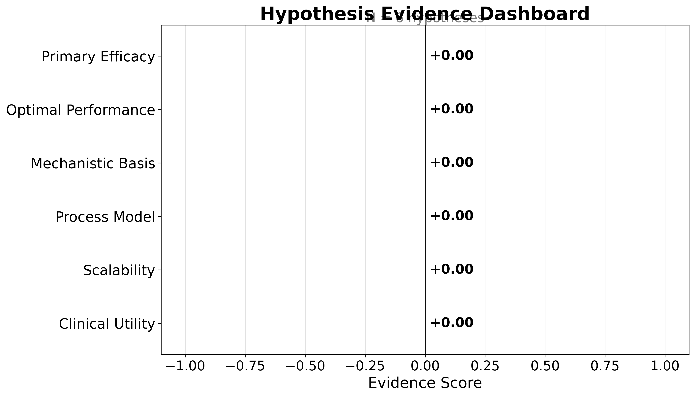

# Results: Hypotheses Explored

The template scores a configurable set of hypotheses about the topic. For this instance
{{N_HYPOTHESES}} hypotheses are declared in configuration; Table 7 lists them with their
scope and evidence score.

**Table 7. Hypotheses explored.**

{{HYPOTHESIS_TABLE}}

Evidence scores are produced by the optional, LLM-gated knowledge-graph stage. When
extraction is skipped and no assertions are available, scores read *pending*.
This run used {{TOTAL_ASSERTIONS}} extracted assertions. Table 7 lists the
configured hypotheses and their scopes.

## Interpretation

Reported scores, when present, should be read as relative rankings rather than calibrated
probabilities: absolute magnitudes are inflated by publication bias and the linguistic
asymmetry of academic writing. A positive score indicates that the retrieved corpus
*talks about* the hypothesis in a supporting direction; a negative score indicates
contradicting evidence; a score near zero indicates either balanced evidence or
insufficient coverage.

<!-- FIGURE: hypothesis_dashboard.png -->
{#fig:hypothesis_dashboard}
