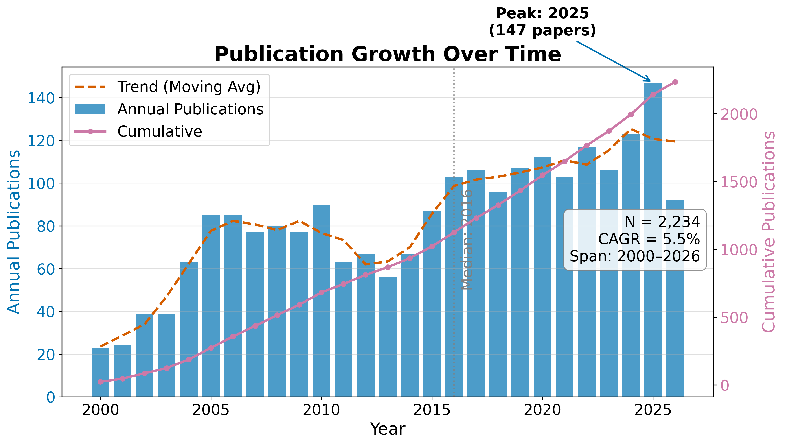
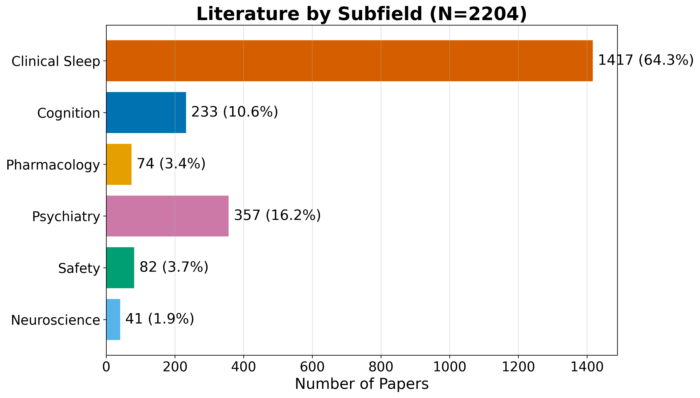
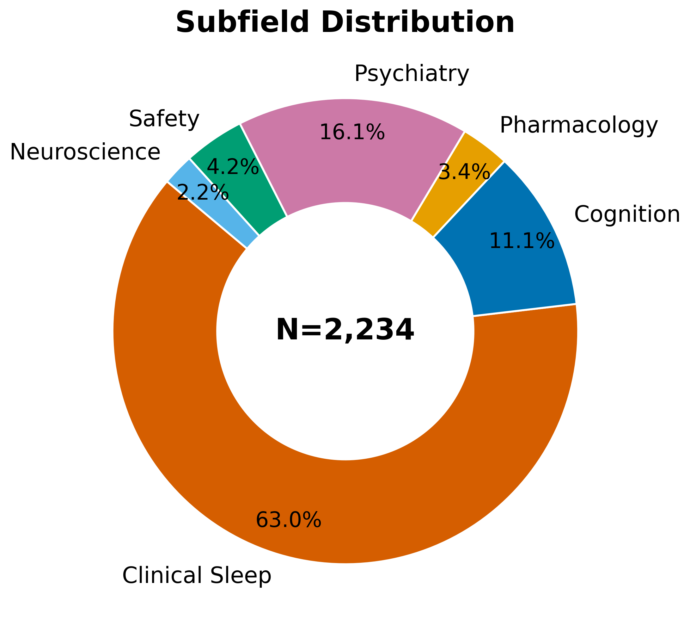
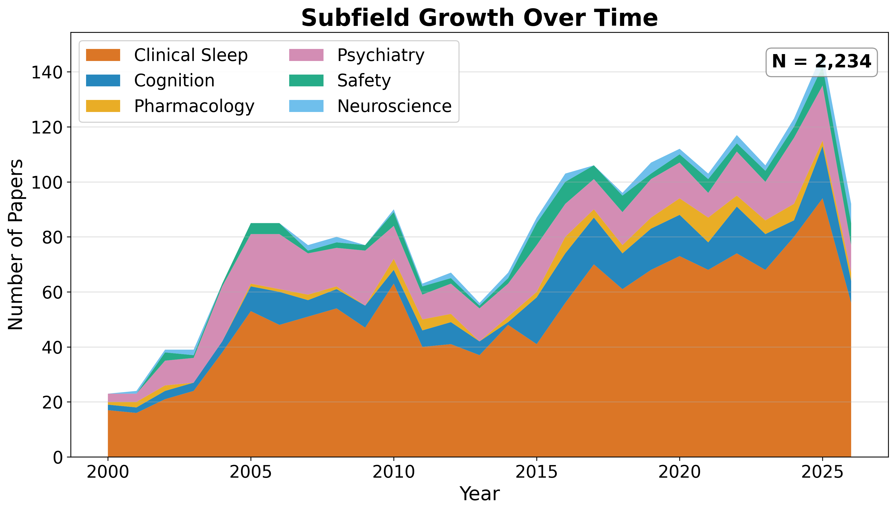
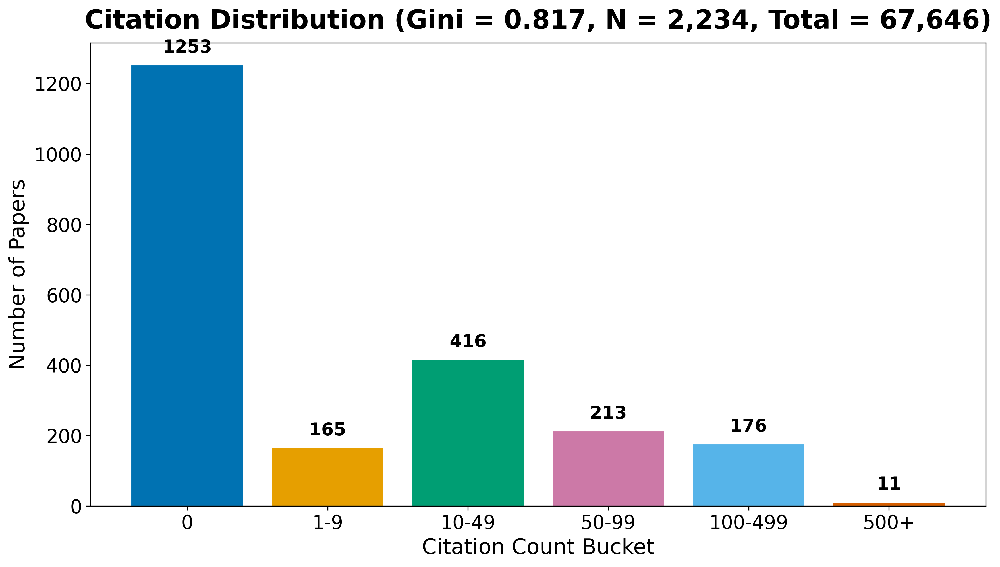
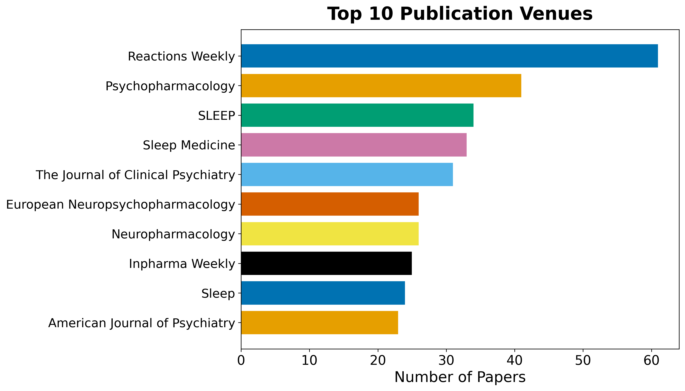
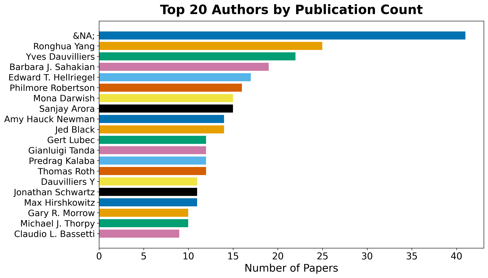

# Results: Field Overview

The de-duplicated corpus for **{{SEARCH_TERM_TITLE}}** contains $N = {{CORPUS_SIZE}}$
records spanning {{YEAR_START}}--{{YEAR_END}} ({{YEAR_SPAN}} years). Publication volume
grows at a compound annual rate of {{CAGR_PCT}}\% (mean year-over-year growth
{{MEAN_YOY_GROWTH_PCT}}\%, doubling time {{DOUBLING_TIME}} years), peaking in {{PEAK_YEAR}}
with {{PEAK_YEAR_PUBS}} records that year.

<!-- FIGURE: growth_curve.png -->
{#fig:growth_curve}

## RQ1: Field Size and Growth

Table 1 reports the highest annual counts for the analyzed records. The counts
depend on the corpus, the date range, and the coverage of the input records.

**Table 1. Top publication years.**

{{YEAR_COUNT_TABLE}}

## RQ2: Subfield Composition

Records distribute across the {{N_SUBFIELDS}} configured subfields as shown in Table 2,
with **{{TOP_SUBFIELD}}** the largest bucket at {{TOP_SUBFIELD_PCT}}\% of the classified
corpus. The counts reflect the current input and the configured classification
keywords.

**Table 2. Subfield distribution.**

{{SUBFIELD_TABLE}}

<!-- FIGURE: field_summary.png -->
{#fig:field_summary}

<!-- FIGURE: subfield_distribution.png -->
{#fig:subfield_distribution}

<!-- FIGURE: subfield_timeline.png -->
{#fig:subfield_timeline}

## Identifier and Full-Text Coverage

The corpus has strong identifier coverage: {{DOI_COUNT}} of {{CORPUS_SIZE}} records
({{PCT_WITH_DOI}}\%) carry DOIs, enabling robust cross-engine de-duplication.
OpenAlex IDs are present for {{OPENALEX_ID_COUNT}} records. Abstract coverage stands at
{{ABSTRACT_COVERAGE_PCT}}\% ({{ABSTRACT_COUNT}} records), which limits the text analytics
to that subset. Open access is confirmed for {{OA_PCT}}\% of records, and
{{PDF_AVAIL_PCT}}\% have a direct PDF link.

## Descriptive Bibliometrics

The corpus spans {{UNIQUE_AUTHORS}} unique authors across {{CORPUS_SIZE}} papers, yielding
a mean of {{PAPERS_PER_AUTHOR_MEAN}} papers per author. Citation counts range from zero to
{{CITATION_MAX}} (mean {{CITATION_MEAN}}, median {{CITATION_MEDIAN}}), with a total of
{{CITATION_TOTAL}} citations across the corpus. The Gini coefficient of citation
concentration is {{GINI_COEFFICIENT}}, indicating a highly skewed distribution
characteristic of scientific literature.

**Table 3. Citation count distribution.**

{{CITATION_DIST_TABLE}}

<!-- FIGURE: citation_distribution.png -->
{#fig:citation_distribution}

**Table 4. Top publication venues.**

{{TOP_VENUES_TABLE}}

<!-- FIGURE: top_venues.png -->
{#fig:top_venues}

**Table 5. Top authors by publication count.**

{{TOP_AUTHORS_TABLE}}

<!-- FIGURE: author_productivity.png -->
{#fig:author_productivity}
