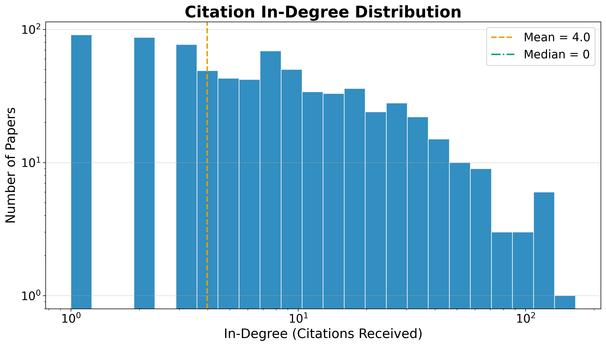

# Results: Citation Network

## RQ4: Citation Geometry

Resolving each record's references against the corpus yields an intra-corpus citation
graph (built and analyzed with NetworkX [@hagberg2008exploring]) of {{CITATION_NODES}}
nodes and {{CITATION_EDGES}} edges across {{CITATION_COMPONENTS}} connected components,
with a graph density of {{CITATION_DENSITY_PCT}}\% and a mean in-degree of
{{MEAN_IN_DEGREE}}. Of {{CITATION_TOTAL_REFS}} total outgoing references,
{{CITATION_RESOLUTION_PCT}}\% resolve to another record inside the corpus — a resolution
rate that reflects how self-contained the retrieved slice of the literature is rather
than the underlying citation density of any single work.

The citation network has {{CITATION_COMMUNITIES}} communities (detected by modularity
optimization), a maximum in-degree of {{CITATION_MAX_IN_DEGREE}} (the most-cited paper
within the corpus), and a maximum out-degree of {{CITATION_MAX_OUT_DEGREE}} (the paper
that cites the most other corpus members).

## Centrality Analysis

Centrality scores (PageRank [@page1999pagerank] and HITS) and modularity-based community
detection [@clauset2004finding] are rounded and ranked with a stable tiebreaker so the
reported hub and authority rankings are byte-reproducible across runs despite the
floating-point non-associativity of the underlying iterative solvers.

**Table 4. Top 5 papers by PageRank.**

{{TOP_PAGERANK_TABLE}}

**Table 5. Top 5 authority papers (HITS).**

{{TOP_AUTHORITIES_TABLE}}

**Table 6. Top 5 hub papers (HITS).**

{{TOP_HUBS_TABLE}}

The highest-ranked paper by PageRank has DOI {{TOP_PAGERANK_DOI}}. PageRank and
HITS describe position in this corpus's citation graph. The ranks depend on
which references resolve within the corpus.

<!-- FIGURE: citation_network.png -->
{#fig:citation_network}

<!-- FIGURE: degree_distribution.png -->
{#fig:degree_distribution}

## Advanced Network Metrics

Beyond PageRank and HITS, the network analysis computes betweenness centrality (which
papers bridge different communities), closeness centrality (which papers are near all
others), degree assortativity (do highly-cited papers cite other highly-cited papers?),
and average clustering coefficient (how tightly knit are local neighborhoods).

The degree assortativity coefficient is {{DEGREE_ASSORTATIVITY}}, and the average
clustering coefficient is {{AVG_CLUSTERING}}. A negative assortativity indicates that
highly-cited papers tend to cite less-cited papers (dissortative mixing), which is
typical of citation networks where review papers (high in-degree) cite many primary
studies (low in-degree).

**Table 7. Top 5 papers by betweenness centrality.**

{{TOP_BETWEENNESS_TABLE}}

Papers with high betweenness centrality serve as bridges between different topical
communities in the citation network — their removal would fragment the graph into
disconnected components. These bridging papers are often review articles or
methodological papers that connect disparate research threads.
